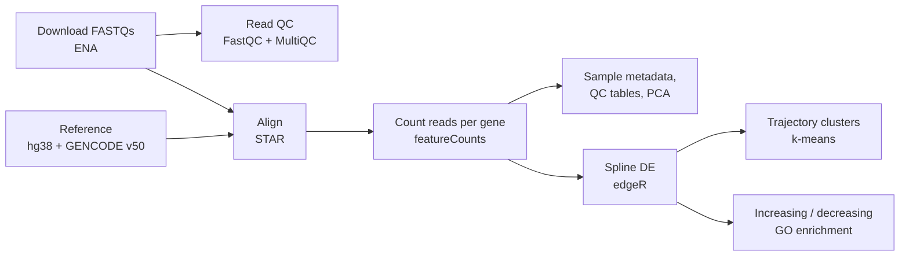

# Human prenatal forebrain development: RNA-seq across 4–20 weeks post-conception

This project re-analyses bulk RNA-seq of the developing human forebrain from
Cardoso-Moreira *et al.* (2019, *Nature*), ArrayExpress
[E-MTAB-6814](https://www.ebi.ac.uk/biostudies/arrayexpress/studies/E-MTAB-6814).
It takes 32 prenatal samples from raw reads to gene counts, then asks which genes
change in expression as the forebrain develops and what biological processes
those genes represent.

Age is treated as a continuous variable. Each gene gets a smooth expression
trajectory (a natural cubic spline in edgeR), genes whose trajectory is not flat
are called age-varying, and those genes are grouped by the shape and direction
of their trajectory and tested for GO enrichment.

**Main finding so far:** genes whose expression rises with age are enriched for
synaptic signalling and neuronal maturation, while genes whose expression falls
are enriched for cell-cycle, DNA replication and DNA repair processes. This is
consistent with a developmental shift from proliferation to neuronal maturation.
Because this is bulk tissue, it likely reflects changes in cell-type composition
(fewer dividing progenitors, more maturing neurons) as well as changes within
cells.

---

## Contents

- [Data](#data)
- [Pipeline overview](#pipeline-overview)
- [Folder layout](#folder-layout)
- [Setup](#setup)
- [Running the pipeline](#running-the-pipeline)
- [Methods summary](#methods-summary)
- [Outputs](#outputs)
- [Known issues and to-dos](#known-issues-and-to-dos)
- [Reference](#reference)

---

## Data

| | |
|---|---|
| Source | ArrayExpress E-MTAB-6814 (raw reads from ENA) |
| Tissue | Prenatal forebrain (prenatally this includes the midbrain; some samples are labelled "Brain") |
| Samples | 32 runs: 11 female, 21 male |
| Ages | 13 time points from 4 to 20 weeks post-conception (wpc) |
| Library | TruSeq stranded mRNA (poly-A), reverse-stranded, single-end ~100 nt |
| Depth | 17–45 M reads per sample (median per time point 21–42 M) |

The sample sheet is `raw/samples.tsv` (run, sample name, BioSample, wpc, sex).
Ages in the sample names are given as weeks (e.g. `11w`) or Carnegie stages
(e.g. `CS21`); the `wpc` column holds the converted age used in all analyses.
Samples per time point are in `analysis/data/sample_summary.tsv`.

---

## Pipeline overview



| Step | Runs on | Script(s) | Main output |
|---|---|---|---|
| 1. Download reads + metadata | Euler | `raw/scripts/download-fastq.sh` | `raw/fastq/*.fastq.gz`, `raw/samples.tsv`, `raw/ena/` |
| 2. Read quality control | Euler (Slurm) | `library_qc/scripts/submit-quality-control.sh` | `library_qc/multiqc/fastq_qc_report.html` |
| 3. Reference genome + STAR index | Euler (Slurm) | `index/scripts/download-genome.sh`, `download-gtf.sh`, `slurm-build-index.sh` | `index/star-index/` |
| 4. Alignment | Euler (Slurm) | `alignment/scripts/submit-align-fastq.sh` | `alignment/mapping/<sample>/` (BAM + `Log.final.out`) |
| 5. Gene counting | Euler (Slurm) | `alignment/scripts/submit-feature-counting.sh` | `quantification/Output/gene_counts_*` |
| 6. Sample metadata | Local R | `analysis/exploratory/01_samples.R` | `analysis/data/sample_metadata.tsv` |
| 7. Read assignment QC | Local R | `analysis/exploratory/02_multi_vs_unique.R` | `Results-presentation/Tables/read_fate_unique.png` |
| 8. Protein-coding count matrix (used by all analyses) | Local R | `analysis/Data-pre-processing.R` | `analysis/data/processed_count_matrix.csv` |
| 9. Exploration (PCA, sex check, heatmap) | Local R | `analysis/exploratory/03_PCA.R`, `04_sex_check.R`, `05_heatmap.R` | `Results-presentation/Figures/pca_age_groups.png` |
| 10. Spline differential expression | Local R | `analysis/spline/DE_spline.R` | `Results-presentation/analysis-output/spline_fit.rds` |
| 11. Trajectory clustering + figures | Local R | `analysis/spline/DE_spline_interpretation.R` | `spline_DE_clusters.csv`, trajectory figures |
| 12. GO enrichment by direction | Local R | `analysis/GSEA/2_cluster_gsea.R` | `*_ora.csv`, `*_ora.png` |

---

## Folder layout

```
.
├── raw/                      Sample sheet, ENA metadata, download script (FASTQs not tracked)
├── library_qc/               FastQC/MultiQC scripts and the MultiQC report
├── index/                    Reference download + STAR index scripts (genome/index not tracked)
├── alignment/
│   ├── scripts/              Slurm jobs: align, count, check BAMs, package outputs
│   ├── processing/           featureCounting.R (run by the counting job)
│   └── mapping/<sample>/     STAR output per sample (only Log.final.out is tracked)
├── quantification/
│   ├── Scripts/              Copy of featureCounting.R
│   └── Output/               Count matrices, featureCounts summaries (not tracked)
├── analysis/
│   ├── data/                 Sample metadata, filtered counts, gene annotation
│   ├── exploratory/          01–05: metadata, read assignment, PCA, sex check, heatmap
│   ├── spline/               Spline DE fit and its interpretation
│   ├── GSEA/                 GO enrichment of increasing/decreasing genes
│   ├── Data-pre-processing.R  Builds the protein-coding matrix every analysis uses
│   ├── run_all.R             Runs the whole R analysis in order
│   └── start_rstudio.sh      Opens the RStudio project with the conda R
├── Results-presentation/
│   ├── Figures/              All figures (quality-control/ holds QC plots + QC_summary.md)
│   ├── Tables/               Summary tables saved as images
│   └── analysis-output/      Fitted model, DE and enrichment tables, edgeR QC plots
├── environments/             Conda/micromamba environment files
├── scripts/                  Build/sync/activate the alignment environment
└── PROJECT_PLAN.md           Project plan and timeline
```

---

## Setup

Raw-data processing (steps 1–5) runs on the ETH **Euler** cluster. The R
analysis (steps 6–12) runs locally in RStudio.

### Euler: install `micromamba`

1. Install it:
    ```sh
    mkdir -p ~/.local/bin
    cd ~/.local/bin
    curl -Ls https://micro.mamba.pm/api/micromamba/linux-64/latest | tar -xvj bin/micromamba --strip-components=1
    ```
2. Configure your shell to load micromamba at login by adding this to `~/.bashrc`:
    ```sh
    export PATH=$HOME/.local/bin:$PATH
    eval "$(micromamba shell hook -s bash)"
    ```
3. Run `bash ~/.bashrc`.

### Euler: alignment environment (`sys-genomics-align`)

Contains STAR, samtools, FastQC, MultiQC, fastp, cutadapt and related tools
(`environments/environment.align.yml`).

- **From the lock file (normal):** from the repository root, run
  `bash ./scripts/sync-align-environment.sh`, then paste the contents of
  `./scripts/activate-align-environment.sh` into your terminal.
- **From scratch:** from the repository root, run
  `bash ./scripts/build-align-environment.sh`.

> The environment files have moved into `environments/`, but these scripts still
> look for them in the repository root. See
> [Known issues](#known-issues-and-to-dos).

### Euler: R for gene counting

The counting job uses R 4.4.1 from the `2025-06` software stack and needs the
Bioconductor packages `Rsubread` and `rtracklayer` in an R library the job can
see. After configuring a writable personal R library, start R with
`module load stack/2025-06` and `module load r/4.4.1`, then install them:

```r
install.packages("BiocManager", repos = "https://cloud.r-project.org")
BiocManager::install(c("Rsubread", "rtracklayer"), ask = FALSE, update = FALSE)
```

### Local: R analysis environment (`forebrain-rnaseq`)

```sh
conda env create -f environments/analysis.yml
./analysis/start_rstudio.sh        # opens the .Rproj with R from this environment
```

The analysis scripts build all paths with `here()`, so they must be run from
the RStudio project (`*.Rproj` in the repository root). Main packages: edgeR,
DESeq2, splines, tidyverse, clusterProfiler, enrichplot, org.Hs.eg.db,
pheatmap, gridExtra.

---

## Running the pipeline

### 1. Download reads (Euler)

```sh
cd raw
bash ./scripts/download-fastq.sh
```

Writes `samples.tsv`, the ENA metadata in `ena/`, and FASTQs in `fastq/`. The
script throttles parallel downloads, resumes partial files, verifies every file
against its ENA MD5 checksum, and can be re-run safely. Options are set with
environment variables (`JOBS`, `PROTO`, `LIMIT_RATE`, `DRY_RUN=1`, `SKIP_MD5=1`).

### 2. Read quality control (Euler)

```sh
bash library_qc/scripts/submit-quality-control.sh
```

Runs FastQC as a Slurm array (one task per FASTQ), then MultiQC once all tasks
finish. Report: `library_qc/multiqc/fastq_qc_report.html`. Interpretation:
`Results-presentation/Figures/quality-control/QC_summary.md`.

### 3. Reference and STAR index (Euler)

```sh
cd index/reference_genome
source ../scripts/download-genome.sh     # hg38 FASTA (UCSC)
source ../scripts/download-gtf.sh        # GENCODE v50 basic annotation
cd ..
sbatch scripts/slurm-build-index.sh      # writes index/star-index/
```

### 4. Alignment (Euler)

```sh
cd alignment
bash scripts/submit-align-fastq.sh       # Slurm array, 5 samples at a time
bash scripts/quick-check-bams.sh         # samtools quickcheck on all BAMs
```

Each sample gets `alignment/mapping/<run>_<sample_name>/` containing a sorted,
indexed BAM and STAR's `Log.final.out`. To archive the mapping folder afterwards:
`bash scripts/submit-package-outputs.sh` (zstd-compressed tarball).

### 5. Gene counting (Euler)

From the repository root:

```sh
bash alignment/scripts/submit-feature-counting.sh
```

Runs `alignment/processing/featureCounting.R`. It writes count matrices to
`counts/` twice: once with uniquely mapped reads only and once including
multimapping reads. These files were then moved to `quantification/Output/`,
which is where the analysis scripts read them. Logs go to `alignment/logs/`.

### 6–12. Analysis (local, RStudio)

To run everything in one go, from the project root:

```sh
Rscript analysis/run_all.R
```

or `source("analysis/run_all.R")` in RStudio. Each script runs in a clean
environment, and the run stops at the first script that fails. To skip steps
that are already up to date, set `run_from` at the top of `run_all.R` (for
example `run_from <- 8` reruns only the clustering and the enrichment).

The scripts, in the order `run_all.R` runs them:

| Order | Script | Needs | Produces |
|---|---|---|---|
| 1 | `analysis/exploratory/01_samples.R` | `raw/samples.tsv`, `raw/ena/read_run.tsv` | `sample_metadata.tsv`, `sample_summary.tsv`, `sample_overview.png` |
| 2 | `analysis/exploratory/02_multi_vs_unique.R` | featureCounts summary | `read_fate_unique.png`, `qc_featureCounts.png` |
| 3 | `analysis/Data-pre-processing.R` | unique count matrix, annotation, metadata | `processed_count_matrix.csv`, `gene_annotation.tsv`, `preprocessing_gene_numbers.tsv` |
| 4 | `analysis/exploratory/03_PCA.R` | output of step 3 | `pca_age_groups.png` |
| 5 | `analysis/exploratory/04_sex_check.R` | full annotated count table (XIST is non-coding) | XIST vs RPS4Y1 plot |
| 6 | `analysis/exploratory/05_heatmap.R` | output of step 3 | heatmap of the top 50 variable genes |
| 7 | `analysis/spline/DE_spline.R` | output of step 3, metadata | `spline_fit.rds`, `spline_DE_all_genes.csv`, `qc_plots.pdf` |
| 8 | `analysis/spline/DE_spline_interpretation.R` | `spline_fit.rds` | `spline_DE_clusters.csv`, elbow, preview, cluster and top-gene figures |
| 9 | `analysis/GSEA/2_cluster_gsea.R` | `spline_fit.rds` | `first_vs_last_ora.*`, `trajectory_inc_vs_dec_ora.*` |

`DE_spline.R` is the only slow step. It saves everything later scripts need in
`spline_fit.rds`, so the clustering and enrichment can be changed and re-run
without refitting the model.

---

## Methods summary

**Read QC.** FastQC (v0.13.0) and MultiQC. Quality was good across all samples;
no trimming step is part of the pipeline. Two samples were examined in more
detail and kept: ERR2598151 (lowest depth, highest duplication) and ERR2598121
(lowest assignment rate, mostly multimapping reads). Details in `QC_summary.md`.

**Alignment.** STAR, against hg38 (UCSC FASTA), sorted BAM output, indexed with
samtools. The index was built from the genome sequence only (no annotation).

**Counting.** `Rsubread::featureCounts` with GENCODE v50 basic: exons summarised
to genes (`gene_id`), reverse-stranded (`strandSpecific = 2`). Counted once with
unique reads only and once including multimappers. The unique-read matrix
(78,733 genes) is the starting point for all analyses; the comparison of the two
is in `02_multi_vs_unique.R`.

**Gene filtering** (`Data-pre-processing.R`). Every downstream analysis (PCA,
heatmap, spline DE, clustering, GO enrichment) uses the same matrix:
protein-coding genes only, as in Cardoso-Moreira *et al.*, with at least 10
reads in at least 3 samples (15,543 genes). The number of genes left after each
step is saved in `analysis/data/preprocessing_gene_numbers.tsv`. The one
exception is the sex check, which uses the full table because XIST is a
non-coding gene.

**Exploration.** For PCA, the filtered protein-coding counts were transformed
with DESeq2's variance-stabilising transformation, and PCA was run on the 500
most variable genes.

**Spline differential expression** (`DE_spline.R`, edgeR):

- The filtered protein-coding matrix, with edgeR's own `filterByExpr` applied
  on top (it uses the design to decide what counts as expressed), then TMM
  normalisation.
- Design: intercept + natural cubic spline of age, `ns(wpc, df = 3)`. Sex is not
  in the model.
- `estimateDisp(robust = TRUE)`, `glmQLFit(robust = TRUE)`.
- Joint quasi-likelihood F-test on the three spline coefficients: is the gene's
  trajectory flat? Genes with FDR < 0.05 are called age-varying.

**Fitted trajectories.** Each gene's fitted curve is predicted at 100 evenly
spaced ages between 4 and 20 wpc: a design matrix is built with one row per age,
the spline basis values at those ages are computed from the same knots as the
fit, and that matrix is multiplied by the gene's fitted coefficients.

**Trajectory clustering** (`DE_spline_interpretation.R`). Curves are z-scored per
gene so only their shape matters, then clustered with k-means (k = 6, chosen
from the elbow and cluster-preview plots; 50 random starts, seed 1). Clusters
are numbered by the age at which they peak, early to late.

**Direction of change and GO enrichment** (`2_cluster_gsea.R`). Age-varying
genes are split two ways:

1. *Endpoints:* the sign of the fitted log2 change from the youngest to the
   oldest age (increasing vs decreasing).
2. *Full trajectory:* the Spearman correlation of each fitted curve with age.
   ρ ≥ 0.8 is increasing, ρ ≤ −0.8 is decreasing, anything in between is
   transient (changes direction).

Each group is tested for over-representation of GO Biological Process terms
with `clusterProfiler::enrichGO` (hypergeometric test, Benjamini–Hochberg
adjusted p < 0.05). The background is every gene tested in the DE model, not
the whole genome.

---

## Outputs

### Figures (`Results-presentation/Figures/`)

| File | Shows |
|---|---|
| `sample_overview.png` | Every sample by age and sequencing depth, coloured by sex |
| `quality-control/fastqc_*.png`, `qc_featureCounts.png` | Read quality and read assignment per sample |
| `pca_age_groups.png` | PCA of samples coloured by age, with age-group means |
| `spline_elbow.png`, `spline_cluster_preview.png` | Choosing the number of trajectory clusters |
| `spline_trajectory_clusters.png` | Scaled trajectories of all age-varying genes per cluster |
| `spline_top_genes.png` | The 9 most significant genes: observed expression with fitted curve |
| `first_vs_last_ora.png` | GO enrichment: decreasing vs increasing (endpoint method) |
| `trajectory_inc_vs_dec_ora.png` | GO enrichment: decreasing vs increasing vs transient (trajectory method) |

### Tables (`Results-presentation/analysis-output/` and `Tables/`)

| File | Contents |
|---|---|
| `spline_fit.rds` | Fitted edgeR model, design, spline basis, metadata and test results (input for later scripts) |
| `spline_DE_all_genes.csv` | Spline test result for every tested gene (logCPM, F, p-value, FDR) |
| `spline_DE_clusters.csv` | Age-varying genes with their trajectory cluster |
| `first_vs_last_ora.csv`, `trajectory_inc_vs_dec_ora.csv` | Full GO enrichment results, including the genes behind each term |
| `qc_plots.pdf` | edgeR checks: MDS coloured by age, BCV, QL dispersion |
| `Tables/sample_summary.png`, `Tables/read_fate_unique.png` | Samples per age; featureCounts read categories |
| `analysis/data/preprocessing_gene_numbers.tsv` | Genes remaining after each filtering step |

With the trajectory method at the current cutoff, the transient group has no
significantly enriched GO terms, so the plot shows only the decreasing and
increasing columns.

---

## Known issues and to-dos

Found while writing this README. Apart from the first item, none of them
affect the results already produced, but they matter for re-running the
pipeline from scratch.

**Rerun needed**

- [ ] The spline DE now uses the protein-coding matrix (it previously used all
      gene types). Everything in `Results-presentation/` from the spline DE
      onwards was made with the old setup, so rerun the analysis
      (`Rscript analysis/run_all.R`, or at least `Data-pre-processing.R` →
      `DE_spline.R` → `DE_spline_interpretation.R` → `2_cluster_gsea.R`).

**Analysis scripts**

- [ ] `analysis/GSEA/2_cluster_gsea.R` is the earlier, untidied version. The
      current `*_ora.csv`/`*_ora.png` outputs came from the tidied version
      (settings block, fixed Decreasing → Increasing → Transient order, saved
      tables). Replace the file with that version.
- [ ] `analysis/GSEA/full_gsea.R` is empty (planned ranked-list GSEA).
- [ ] `DE_spline.R`: the `adjust_sex` setting is defined but not used; sex is
      never added to the design. Either remove it or add sex to the design
      when it is `TRUE`.
- [ ] `02_multi_vs_unique.R`: the header lists `analysis/data/read_fate_unique.tsv`
      as an output, but only the PNGs are written.

**Euler scripts**

- [ ] `scripts/build-align-environment.sh` and `sync-align-environment.sh` look
      for `environment.align.yml` / `environment.align.lock.txt` in the repository
      root; they are now in `environments/`.
- [ ] The QC folder was renamed from `quality_control/` to `library_qc/`, but the
      usage comment in `submit-quality-control.sh` and the `.gitignore` rules
      still use the old name, so FastQC outputs in `library_qc/` are no longer
      ignored by git.
- [ ] `featureCounting.R` writes to `counts/`, but the outputs live in
      `quantification/Output/`. The script also exists in two places
      (`alignment/processing/` and `quantification/Scripts/`, currently
      identical); keep one.
- [ ] `slurm-build-index.sh` uses a micromamba root on scratch
      (`/cluster/scratch/$USER/sys-genomics/micromamba`); the other jobs use
      `<repo>/micromamba`.
- [ ] `raw/scripts/download-fastq.sh` says two samples named "20w" are annotated
      as 19 wpc and are corrected, but the sample sheet still lists both
      (5668sTS, 5770sTS) as 20 wpc. Check which age is intended.

**Project plan**

- [ ] `PROJECT_PLAN.md`: tick off the completed steps.

---

## Reference

Cardoso-Moreira M, Halbert J, Valloton D, *et al.* Gene expression across
mammalian organ development. *Nature* 571, 505–509 (2019).
https://doi.org/10.1038/s41586-019-1338-5
