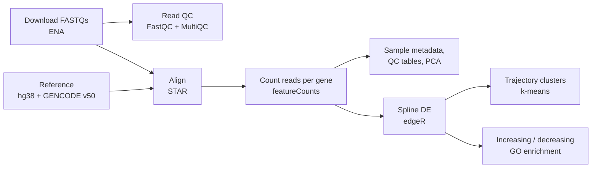

# Human prenatal forebrain development: RNA-seq across 4–20 weeks post-conception

This project re-analyses bulk RNA-seq of the developing human forebrain from Cardoso-Moreira *et al.* (2019, *Nature*), ArrayExpress [E-MTAB-6814](https://www.ebi.ac.uk/biostudies/arrayexpress/studies/E-MTAB-6814). It takes 32 prenatal samples from raw reads to gene counts, then asks which genes change in expression as the forebrain develops and what biological processes those genes represent.

Age is treated as a continuous variable. Each gene gets a smooth expression trajectory (a natural cubic spline in edgeR), genes whose trajectory is not flat are called age-varying, and those genes are grouped by the shape and direction of their trajectory and tested for GO enrichment.

**Main finding so far:** genes whose expression rises with age are enriched for synaptic signalling and neuronal maturation, while genes whose expression falls are enriched for cell-cycle, DNA replication and DNA repair processes. This is consistent with a developmental shift from proliferation to neuronal maturation. Because this is bulk tissue, it likely reflects changes in cell-type composition (fewer dividing progenitors, more maturing neurons) as well as changes within cells.

------------------------------------------------------------------------

## Contents

- [Data](#data)
- [Pipeline overview](#pipeline-overview)
- [Folder layout](#folder-layout)
- [Setup](#setup)
- [Running the pipeline](#running-the-pipeline)
- [Methods summary](#methods-summary)
- [Outputs](#outputs)
- [Known issues and to-dos](#known-issues-and-to-dos)
- [Reference](#reference)

------------------------------------------------------------------------

## Data {#data}

|  |  |
|------------------------------------|------------------------------------|
| Source | ArrayExpress E-MTAB-6814 (raw reads from ENA) |
| Tissue | Prenatal forebrain (prenatally this includes the midbrain; some samples are labelled "Brain") |
| Samples | 32 runs: 11 female, 21 male |
| Ages | 13 time points from 4 to 20 weeks post-conception (wpc) |
| Library | TruSeq stranded mRNA (poly-A), reverse-stranded, single-end \~100 nt |
| Depth | 17–45 M reads per sample (median per time point 21–42 M) |

The sample sheet is `raw/samples.tsv` (run, sample name, BioSample, wpc, sex). Ages in the sample names are given as weeks (e.g. `11w`) or Carnegie stages (e.g. `CS21`); the `wpc` column holds the converted age used in all analyses. Samples per time point are in `analysis/data/sample_summary.tsv`.

------------------------------------------------------------------------

## Pipeline overview {#pipeline-overview}



| Step | Runs on | Script(s) | Main output |
|------------------|------------------|------------------|------------------|
| 1\. Download reads + metadata | Euler | `preprocessing/scripts/raw/download-fastq.sh` | `raw/fastq/*.fastq.gz`, `raw/samples.tsv`, `raw/ena/` |
| 2\. Read quality control | Euler (Slurm) | `preprocessing/scripts/qc/submit-quality-control.sh` | `library_qc/multiqc/fastq_qc_report.html` |
| 3\. Reference genome + STAR index | Euler (Slurm) | `preprocessing/scripts/reference/` | `index/star-index/` |
| 4\. Alignment | Euler (Slurm) | `preprocessing/scripts/alignment/submit-align-fastq.sh` | `alignment/mapping/<sample>/` (BAM + `Log.final.out`) |
| 5\. Gene counting | Euler (Slurm) | `preprocessing/scripts/counting/submit-feature-counting.sh` | `quantification/Output/gene_counts_*` |
| 6\. Sample metadata | Local R | `analysis/exploratory/01_samples.R` | `analysis/data/sample_metadata.tsv` |
| 7\. Read assignment QC | Local R | `analysis/exploratory/02_multi_vs_unique.R` | `Results-presentation/Tables/read_fate_unique.png` |
| 8\. Protein-coding count matrix (used by all analyses) | Local R | `analysis/data-pre-processing/Data-pre-processing.R` | `analysis/data/processed_count_matrix.csv` |
| 9\. Exploration (PCA, sex check, heatmap) | Local R | `analysis/exploratory/03_PCA.R`, `04_sex_check.R`, `05_heatmap.R` | `Results-presentation/Figures/pca_age_groups.png` |
| 10\. Spline differential expression | Local R | `analysis/spline/DE_spline.R` | `Results-presentation/analysis-output/spline_fit.rds` |
| 11\. Trajectory clustering + figures | Local R | `analysis/spline/DE_spline_interpretation.R` | `spline_DE_clusters.csv`, trajectory figures |
| 12\. GO enrichment by direction | Local R | `analysis/GSEA/2_cluster_gsea.R` | `*_ora.csv`, `*_ora.png` |
| 13\. MSigDB enrichment per trajectory cluster | Local R | `analysis/GSEA/6_gene_set_analysis.R` | `fora_*.csv`, `fora_*.png` |

------------------------------------------------------------------------

## Folder layout {#folder-layout}

```         
.
├── preprocessing/
│   ├── pixi.toml, pixi.lock # Locked HPC tools, including R for counting
│   ├── pixi.sh              # Project-local Pixi runtime wrapper
│   └── scripts/             # Slurm install and raw, QC, reference, alignment, counting
├── raw/                      Sample sheet, ENA metadata (FASTQs not tracked)
├── library_qc/               FastQC/MultiQC outputs and report
├── index/                    Reference and STAR index (not tracked)
├── alignment/mapping/        STAR output per sample (only Log.final.out is tracked)
├── quantification/Output/    Count matrices, featureCounts summaries (not tracked)
├── analysis/
│   ├── data/                 Sample metadata, filtered counts, gene annotation
│   ├── exploratory/          01–05: metadata, read assignment, PCA, sex check, heatmap
│   ├── spline/               Spline DE fit and its interpretation
│   ├── GSEA/                 GO enrichment by direction and per trajectory cluster
│   ├── data-pre-processing/  Builds the protein-coding matrix every analysis uses
│   ├── run_all.R             Runs the whole R analysis in order
├── Results-presentation/
│   ├── Figures/              All figures (quality-control/ holds QC plots + QC_summary.md)
│   ├── Tables/               Summary tables saved as images
│   └── analysis-output/      Fitted model, DE and enrichment tables, edgeR QC plots
└── environments/             Separate R analysis environment and legacy alignment lock
```

Preprocessing code lives in `preprocessing/`; data and results remain at their
existing paths so downstream R scripts and existing artifacts do not need to
move. `raw/` holds the sample sheet, ENA records and downloaded reads;
`library_qc/` holds QC reports; `index/` holds reference files and the STAR
index; `alignment/mapping/` holds per-sample alignment outputs; and
`quantification/Output/` is the handoff to `analysis/`. Large generated files
are generally not tracked; selected QC reports and STAR summary logs are.

------------------------------------------------------------------------

## Setup {#setup}

Raw-data processing (steps 1–5) runs on the ETH **Euler** cluster. The R analysis (steps 6–12) runs locally in RStudio.

### Euler: Pixi preprocessing environment

Install Pixi separately and make it available on the submission shell's PATH
(or set `PIXI_BIN` to its absolute executable path). Submit the locked
installation from the repository root:

``` sh
bash preprocessing/scripts/submit-install.sh
```

Check the job with `squeue` or `sacct` and its log in
`preprocessing/logs/pixi-install-<jobid>.log`; wait for successful completion
before submitting preprocessing. The job requests eight CPUs on one node:
Pixi parallelizes package downloads and extraction, not installation across
multiple nodes. It needs network access and a shared project filesystem.
Avoid running multiple installs simultaneously. The environment is installed
to `preprocessing/.pixi/`, and Pixi caches, temporary files, home and R user
library are kept in `preprocessing/.runtime/`. The batch jobs use the prepared
environment offline with `--as-is`; they do not solve or install dependencies.
The installer checks the main tools and R packages before marking the
environment ready. Repeat the install job after changing the manifest or lock
file, or recreating the environment.
`environments/environment.align.yml` and its explicit lock are retained only
as a reference for the former micromamba environment.

### Local: R analysis environment (`forebrain-rnaseq`)

``` sh
conda env create -f environments/analysis.yml
conda activate forebrain-rnaseq
Rscript analysis/run_all.R
```

The analysis scripts build all paths with `here()`, so they must be run from the RStudio project (`*.Rproj` in the repository root). Main packages: edgeR, DESeq2, splines, tidyverse, clusterProfiler, enrichplot, org.Hs.eg.db, pheatmap, gridExtra.

------------------------------------------------------------------------

## Running the pipeline {#running-the-pipeline}

### 1. Download reads (Euler)

``` sh
bash preprocessing/scripts/raw/download-fastq.sh
```

Writes `samples.tsv`, the ENA metadata in `ena/`, and FASTQs in `fastq/`. The script throttles parallel downloads, resumes partial files, verifies every file against its ENA MD5 checksum, and can be re-run safely. Options are set with environment variables (`JOBS`, `PROTO`, `LIMIT_RATE`, `DRY_RUN=1`, `SKIP_MD5=1`).

### 2. Read quality control (Euler)

``` sh
bash preprocessing/scripts/qc/submit-quality-control.sh
```

Runs FastQC as a Slurm array (one task per FASTQ), then MultiQC once all tasks finish. Report: `library_qc/multiqc/fastq_qc_report.html`. Interpretation: `Results-presentation/Figures/quality-control/QC_summary.md`.

### 3. Reference and STAR index (Euler)

``` sh
bash preprocessing/scripts/reference/download-genome.sh
bash preprocessing/scripts/reference/download-gtf.sh
bash preprocessing/scripts/reference/submit-build-index.sh
```

The downloaded UCSC FASTA is reduced to `chr1`–`chr22`, `chrX`, `chrY` and
`chrM`; the chrY pseudoautosomal regions are masked, and GENCODE v50 basic is
embedded in the STAR index. To rebuild alignments after replacing an index,
force the array to discard existing BAMs:

``` sh
FORCE_REALIGN=1 bash preprocessing/scripts/alignment/submit-align-fastq.sh
```

### 4. Alignment (Euler)

``` sh
bash preprocessing/scripts/alignment/submit-align-fastq.sh
bash preprocessing/scripts/alignment/quick-check-bams.sh
```

Each sample gets `alignment/mapping/<run>_<sample_name>/` containing a sorted, indexed BAM and STAR's `Log.final.out`. To archive the mapping folder afterwards: `bash preprocessing/scripts/alignment/submit-package-outputs.sh` (zstd-compressed tarball).

### 5. Gene counting (Euler)

From the repository root:

``` sh
bash preprocessing/scripts/counting/submit-feature-counting.sh
```

Runs `preprocessing/scripts/counting/featureCounting.R`. It writes count matrices directly to `quantification/Output/`: once with uniquely mapped reads only and once including multimapping reads. Logs go to `alignment/logs/`.

### 6–12. Analysis (local, RStudio)

To run everything in one go, from the project root:

``` sh
Rscript analysis/run_all.R
```

or `source("analysis/run_all.R")` in RStudio. Each script runs in a clean environment, and the run stops at the first script that fails. To skip steps that are already up to date, set `run_from` at the top of `run_all.R` (for example `run_from <- 8` reruns only the clustering and both enrichments).

The scripts, in the order `run_all.R` runs them:

| Order | Script | Needs | Produces |
|------------------|------------------|------------------|------------------|
| 1 | `analysis/exploratory/01_samples.R` | `raw/samples.tsv`, `raw/ena/read_run.tsv` | `sample_metadata.tsv`, `sample_summary.tsv`, `sample_overview.png` |
| 2 | `analysis/exploratory/02_multi_vs_unique.R` | featureCounts summary | `read_fate_unique.png`, `qc_featureCounts.png` |
| 3 | `analysis/data-pre-processing/Data-pre-processing.R` | unique count matrix, annotation, metadata | `processed_count_matrix.csv`, `gene_annotation.tsv`, `preprocessing_gene_numbers.tsv` |
| 4 | `analysis/exploratory/03_PCA.R` | output of step 3 | `pca_age_groups.png` |
| 5 | `analysis/exploratory/04_sex_check.R` | full annotated count table (XIST is non-coding) | XIST vs RPS4Y1 plot |
| 6 | `analysis/exploratory/05_heatmap.R` | output of step 3 | `heatmap_top50_variable_genes.png` |
| 7 | `analysis/spline/DE_spline.R` | output of step 3, metadata | `spline_fit.rds`, `spline_DE_all_genes.csv`, `qc_plots.pdf` |
| 8 | `analysis/spline/DE_spline_interpretation.R` | `spline_fit.rds` | `spline_DE_clusters.csv`, elbow, preview, cluster and top-gene figures |
| 9 | `analysis/GSEA/2_cluster_gsea.R` | `spline_fit.rds` | `first_vs_last_ora.*`, `trajectory_inc_vs_dec_ora.*` |
| 10 | `analysis/GSEA/6_gene_set_analysis.R` | `spline_fit.rds`, `spline_DE_clusters.csv` | `fora_hallmark_results.csv`, `fora_gobp_results.csv`, four `fora_*.png` figures |

`DE_spline.R` is the only slow step. It saves everything later scripts need in `spline_fit.rds`, so the clustering and enrichment can be changed and re-run without refitting the model.

------------------------------------------------------------------------

## Methods summary {#methods-summary}

**Read QC.** FastQC (v0.13.0) and MultiQC. Quality was good across all samples; no trimming step is part of the pipeline. Two samples were examined in more detail and kept: ERR2598151 (lowest depth, highest duplication) and ERR2598121 (lowest assignment rate, mostly multimapping reads). Details in `QC_summary.md`.

**Alignment.** STAR, against primary-chromosome hg38 (UCSC FASTA) with chrY
pseudoautosomal regions masked and GENCODE v50 basic supplied during index
generation, sorted BAM output, indexed with samtools.

**Counting.** `Rsubread::featureCounts` with GENCODE v50 basic: exons summarised to genes (`gene_id`), reverse-stranded (`strandSpecific = 2`). Counted once with unique reads only and once including multimappers. The unique-read matrix (78,733 genes) is the starting point for all analyses; the comparison of the two is in `02_multi_vs_unique.R`.

**Gene filtering** (`Data-pre-processing.R`). Every downstream analysis (PCA, heatmap, spline DE, clustering, GO enrichment) uses the same matrix: protein-coding genes only, as in Cardoso-Moreira *et al.*, with at least 10 reads in at least 3 samples (15,543 genes). The number of genes left after each step is saved in `analysis/data/preprocessing_gene_numbers.tsv`. The one exception is the sex check, which uses the full table because XIST is a non-coding gene.

**Exploration.** For PCA, the filtered protein-coding counts were transformed with DESeq2's variance-stabilising transformation, and PCA was run on the 500 most variable genes.

**Spline differential expression** (`DE_spline.R`, edgeR):

- The filtered protein-coding matrix, with edgeR's own `filterByExpr` applied on top (it uses the design to decide what counts as expressed), then TMM normalisation.
- Design: intercept + natural cubic spline of age, `ns(wpc, df = 3)`. Sex is not in the model.
- `estimateDisp(robust = TRUE)`, `glmQLFit(robust = TRUE)`.
- Joint quasi-likelihood F-test on the three spline coefficients: is the gene's trajectory flat? Genes with FDR \< 0.05 are called age-varying.

**Fitted trajectories.** Each gene's fitted curve is predicted at 100 evenly spaced ages between 4 and 20 wpc: a design matrix is built with one row per age, the spline basis values at those ages are computed from the same knots as the fit, and that matrix is multiplied by the gene's fitted coefficients.

**Trajectory clustering** (`DE_spline_interpretation.R`). Curves are z-scored per gene so only their shape matters, then clustered with k-means (k = 6, chosen from the elbow and cluster-preview plots; 50 random starts, seed 1). Clusters are numbered by the age at which they peak, early to late.

**Direction of change and GO enrichment** (`2_cluster_gsea.R`). Age-varying genes are split two ways:

1.  *Endpoints:* the sign of the fitted log2 change from the youngest to the oldest age (increasing vs decreasing).
2.  *Full trajectory:* the Spearman correlation of each fitted curve with age. ρ ≥ 0.8 is increasing, ρ ≤ −0.8 is decreasing, anything in between is transient (changes direction).

Each group is tested for over-representation of GO Biological Process terms with `clusterProfiler::enrichGO` (hypergeometric test, Benjamini–Hochberg adjusted p \< 0.05). The background is every gene tested in the DE model, not the whole genome.

------------------------------------------------------------------------

## Outputs {#outputs}

### Figures (`Results-presentation/Figures/`)

| File | Shows |
|------------------------------------|------------------------------------|
| `sample_overview.png` | Every sample by age and sequencing depth, coloured by sex |
| `quality-control/fastqc_*.png`, `qc_featureCounts.png` | Read quality and read assignment per sample |
| `pca_age_groups.png` | PCA of samples coloured by age, with age-group means |
| `heatmap_top50_variable_genes.png` | The 50 most variable protein-coding genes across samples ordered by age, annotated with age and sex |
| `spline_elbow.png`, `spline_cluster_preview.png` | Choosing the number of trajectory clusters |
| `spline_trajectory_clusters.png` | Scaled trajectories of all age-varying genes per cluster |
| `spline_top_genes.png` | The 3 genes with the largest increase and the 3 with the largest decrease with age (consistent direction, mean log2 CPM ≥ 2): observed expression with fitted curve |
| `first_vs_last_ora.png` | GO enrichment: decreasing vs increasing (endpoint method) |
| `trajectory_inc_vs_dec_ora.png` | GO enrichment: decreasing vs increasing vs transient (trajectory method) |

### Tables (`Results-presentation/analysis-output/` and `Tables/`)

| File | Contents |
|------------------------------------|------------------------------------|
| `spline_fit.rds` | Fitted edgeR model, design, spline basis, metadata and test results (input for later scripts) |
| `spline_DE_all_genes.csv` | Spline test result for every tested gene (logCPM, F, p-value, FDR) |
| `spline_DE_clusters.csv` | Age-varying genes with their trajectory cluster |
| `first_vs_last_ora.csv`, `trajectory_inc_vs_dec_ora.csv` | Full GO enrichment results, including the genes behind each term |
| `qc_plots.pdf` | edgeR checks: MDS coloured by age, BCV, QL dispersion |
| `Tables/sample_summary.png`, `Tables/read_fate_unique.png` | Samples per age; featureCounts read categories |
| `analysis/data/preprocessing_gene_numbers.tsv` | Genes remaining after each filtering step |

With the trajectory method at the current cutoff, the transient group has no significantly enriched GO terms, so the plot shows only the decreasing and increasing columns.

------------------------------------------------------------------------

## Known issues and to-dos {#known-issues-and-to-dos}

Found while writing this README. Apart from the first item, none of them affect the results already produced, but they matter for re-running the pipeline from scratch.

**Analysis scripts**

- [ ] `6_gene_set_analysis.R`: the <GO:BP> dot plot and bar chart take the top 5 terms per cluster without an FDR filter, although their subtitles say "FDR \< 0.05"; its "gene ratio" is overlap / pathway size, unlike clusterProfiler's GeneRatio; its header still calls it `DE_spline_enrichment.R`.

**Euler scripts**

- [ ] `preprocessing/scripts/raw/download-fastq.sh` says two samples named "20w" are annotated as 19 wpc and are corrected, but the sample sheet still lists both (5668sTS, 5770sTS) as 20 wpc. Check which age is intended.

------------------------------------------------------------------------

## Reference {#reference}

Cardoso-Moreira M, Halbert J, Valloton D, *et al.* Gene expression across mammalian organ development. *Nature* 571, 505–509 (2019). <https://doi.org/10.1038/s41586-019-1338-5>
